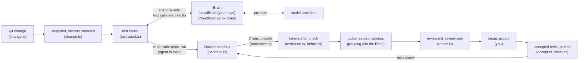

# Developing arnx

arnx reviews a code change by writing tests for it, running them in Docker, and asking the owner what the code
cannot settle. This page is for someone changing arnx itself.

## The shape of it

The CLI keeps the evidence (the change, the snapshot, every tool call, the Docker runs, the before/after check, the
report); a `Brain` keeps the judgement (prompts, models, what to ask next, the hunt, the second opinion and grouping).
A brain never runs a test or reads a file except through a tool call the CLI runs. Details in
[How a review flows](#how-a-review-flows).

## Run it

    bun install
    bun test                          # unit tests: no models, no Docker
    ARNX_DOCKER_TESTS=1 bun test      # also real containers (builds a python:3.12-slim image, pulls postgres)
    bunx tsc --noEmit                 # type check
    bun run smoke                     # builds dist/arnx (single binary) and dist/cli.js (Node bundle), runs both

Tests never call a model. `tests/helpers/fakes.ts` holds a scripted agent, a fake JSON model and a fake Docker
session. `tests/golden.test.ts` compares against files captured from arnx's first version: the
review.yaml hash, the env image key, the prompts, review.md and the settings file must stay byte-identical, so files
written by either version keep working. `tests/prompts-frozen.test.ts` holds every prompt built from
`src/prompts.toml` to the text 0.1.2 built (`tests/fixtures/prompts-0.1.2.json`) and `PROMPT_VERSION` to its value.

The source uses only `node:` built-ins, `fetch` and four dependencies (`@anthropic-ai/sdk`, `yaml`, `smol-toml`,
`fast-xml-parser`), and no Bun-only APIs: the Node bundle must run on Node 20 or later. `tests/clean.test.ts`
enforces the import rule.

## The commands

Each command does one job and writes to a known place. All state lives in the user's repository under `.arnx/`,
except, under the user's config directory (`$XDG_CONFIG_HOME/arnx/`, else `~/.config/arnx/`): the telemetry install
id (`telemetry.json`, one per machine, only once telemetry has sent), the arnx cloud login (`credentials.json`) and
the local pins of accepted tests (`pins/<repo>.json`); and, in Docker, the environment images (`arnx-env:<hash>`).
Accepted tests are kept in `.arnx/tests/`, each at the path it runs from; only `arnx check` puts them in place, in a
throwaway copy.

| Command | Job | Reads | Writes | Models | Docker |
|---|---|---|---|---|---|
| `init` | Write the harness, each role on it when its key is set (else commented, Claude standing in), the known providers and `telemetry = false`; write `.arnxignore` (data, dumps, images; fixtures kept) when absent. Asks nothing, checks nothing (doctor does; the first send asks the consent). Again: keeps what is there, creates what is missing, exit 0. `--force` rewrites the config, keeping the consents, `telemetry`, `[cloud]` and the user's provider tables | env keys, tracked and untracked files (not git-ignored) | `.arnx/config.toml`, `.arnx/.gitignore`, `.arnxignore` (only if absent) | no | no |
| `doctor` | Say what is missing: Configuration, Models, Keys (or arnx cloud's Login and Credits), Docker (✗), then Consent and Environment (· when not done yet); coverage, JEV, the telemetry state and, with Docker running, the unused environment images `env prune` would remove (one line each, never a check); then "Ready for review." or "Not ready for review." and a Next line (the fix, or the flow's next command). setup and review run the same checks first and stop on a ✗ with its line | everything | nothing | no | checks it runs |
| `setup` | doctor's checks, then the consent to send code (asked once; `--yes` gives it); an agent reads the repo and proposes a test environment, proving each proposal by running the existing suite (arnx's probe test for a project with no tests of its own); then runs approve's proof without asking (`--yes` gives only the consent): a project whose part of review.yaml, environment and code (`snapshotDigest`) are what setup's last whole-suite run of it had takes that run as its proof (`SetupRun`), the others run again; it ends with "Worth a look" (`worthALook` in `setupview.ts`: only what applies) and doctor's line on unused images, when there are any. `--project NAME` redoes one project, `--add` covers more; a proven file is set up again only with `--force` | the repo (snapshot) | `.arnx/review.yaml`, `.arnx/setup/` logs and `approval.md` | setup model (default: reviewer) | yes |
| `approve` | The proof, asked nothing: run every suite once more (accepted tests still red, matching their pins, do not block it: "N accepted tests still fail"), stamp the file with a hash (the `approved:` key, its old name; `by` is the git user: arnx does not tell a coding agent from its user), record the proof and its warnings. `review`, `check` and `accept` run it themselves first when review.yaml changed since its proof (`reprove` in `cli.ts`; a failing proof stops them, exit 3). Both say first what changed since the last proof (`describeChanges` in `setupview.ts`, against the copy each proof keeps in `.arnx/setup/proven-review.yaml`, stamp or not; `proofState`: a stamp that holds over content other than the copy's is no proof; no copy: said, and the proof goes on), record it, and put it in the command's JSON (`reproved`); after a passing proof, "Worth a look" and the unused images line | `.arnx/review.yaml`, `.arnx/accepted-tests.json` | the stamp in `.arnx/review.yaml`, `.arnx/setup/approval.md`, `.arnx/setup/proven-review.yaml` | no | yes |
| `review` | Write tests for the current change, run them 3 times, turn stable failures into findings, have a second model challenge each one | the change, the code, the approved environment | `.arnx/reviews/<id>/` | reviewer + challenger | yes |
| `next` | Say where the repository is in the flow and the one command to run now (`next.ts`); with arnx cloud, the login or a top-up first | `.arnx/`, the change | nothing | no | no |
| `triage` | Step through the findings in the terminal: marks, severity, answers | `.arnx/reviews/<id>/` | `review.md`, `triage.json` | no | no |
| `accept` | Read the user's marks and answers from `review.md`; keep real findings as tests; turn answers into tests; pin each kept file's sha256 and its accepted tests; run the accepted tests (`--no-check` skips it); write the fix prompt. `--keep-edits`: record edited accepted tests as they are | `.arnx/reviews/<id>/` | `.arnx/tests/<project root>/tests/arnx/r<id>/`, `.arnx/precision.jsonl`, `.arnx/accepted-tests.json`, `.arnx/answer-watch.json`, `fix-prompt.md`, the local pins | reviewer (answers only) | yes |
| `prompt` | Print the fix prompt of the review accepted last (or the id given) | `.arnx/reviews/<id>/fix-prompt.md` | nothing | no | no |
| `check` | Run the accepted tests in the approved sandbox, accepted tests told from the other tests in their files; refuse (exit 4) when a pinned file or its entry changed. `--review [id]`: run a review's confirmed tests on the working tree instead (`recheck.ts`), before anything is accepted | `.arnx/tests/`, `.arnx/accepted-tests.json`, `.arnx/answer-watch.json`; with `--review`, `.arnx/reviews/<id>/` | `.arnx/run/` logs | no | yes |
| `consent` | Record the consent to send code (`--cloud`: to arnx cloud) without sending anything | `.arnx/config.toml` | `consent_at` or `cloud_consent_at` | no | no |
| `allow-secret` | Pin the key-like strings of test-fixture files, so they are sent and copied; never shows the strings. `--remove PATH...` takes the paths' pins out (the files need not exist; a seed left with none is deleted), so they are withheld again | the files named | `.arnx/review.yaml` (proven again before the next review) | no | no |
| `env prune` | Remove this repository's environment images no approved project uses, older than `--keep-days` (7); `--all-repos`, `--dry-run`. An image made from the code (`<key>-src-<hash>`, baked.ts) also takes the build cache records its build left, each by id, found from the step marked with its tag; one an arnx before 0.1.3 built has no such step (`docker image history` shows it), and its records cannot be told apart from others, so prune names `docker builder prune` instead | Docker's image labels, `docker buildx du` | nothing | no | yes |
| `login`, `logout`, `credits` | arnx cloud: a device login (RFC 8628), its deletion, the balance (no answer: "arnx cloud unavailable", exit 2; "not open yet" only on arnx cloud's `not_open`) | the config directory, `/v1/account` | `~/.config/arnx/credentials.json` (0600) | no | no |
| `cloud on`, `cloud off` | arnx cloud's models for this repository, or the user's keys again: asks the cloud consent once, changes only `[cloud] models` | `.arnx/config.toml` | `.arnx/config.toml` | no | no |
| `prompts` | List the prompt keys, marking those `.arnx/prompts.toml` overrides; `copy KEY` writes arnx's default of KEY there with `KEY_base` (its hash), keeping the file's other content; a key already there is printed instead, nothing written | `.arnx/prompts.toml` | `.arnx/prompts.toml` (copy) | no | no |
| `skill install` | Write the arnx skill for coding agents (`skills/arnx/`, embedded in the build) to `.agents/skills/arnx/` and `.claude/skills/arnx/`, or under `~/` with `--user`; a different copy only with `--force`. `init` names the command until the repository has it | nothing | `.agents/skills/arnx/`, `.claude/skills/arnx/` | no | no |

Exit codes: 0 no confirmed findings, 1 confirmed findings, 2 the run could not finish, 3 setup needed, 4 (`check`
only) an accepted test changed since accept, 130 interrupted.

Every command takes `--json` (`JsonOut` in `cli.ts`): one object on stdout, the text on stderr, nothing asked. The
fields are in `skills/arnx/references/json.md` and `check-json.md`; `tests/json-*.test.ts` hold them.

## How a review flows

    review
      resolveChange        change.ts     uncommitted work, else the last commit, or --range A..B; no commits: every file
      testRound            testround.ts
        snapshot           change.ts     copy of the code at the change's head, secrets removed
        dockerSession      sandbox.ts    build the env image once, start services, internal network
          bakedIn          baked.ts      an older copy of the code in the image: use an image made from this code
                                         (keyed on the code, kept for later sessions; `env prune` removes it)
          probe            testround.ts  arnx's one-line test must pass, else the round stops before any model call
          agentRound       localbrain.ts the brain's round starts with its tools (with --hunt, the tool-less hunters
                                         too); after each final reply, the facts
          runAgent         agent.ts      the model reads, writes tests, runs them (tools only, no shell)
        runTests x3        outcomes.ts   the adapter's command and report -> passed / failed / error, per run;
                                         after a run times out the rest are skipped (no report)
        classify           outcomes.ts   failed in all 3 runs = finding; anything else never is
        beforeStage        testround.ts  findings' files x3 on a snapshot of the change's base, same image
          judgeBefore      before.ts     regression / pre-existing / new-code / changed / unknown, per finding
          judgeFix         before.ts     fix proof, passing tests: fixed / new-code / unchanged / unknown
      buildFindings        reviewer.ts   attach the reviewer's explanation (and the before result) to each finding
      judge                localbrain.ts questions merged, second opinions (challenge.ts), grouping (explain.ts)
      save                 report.ts     review.md for people, review.json for arnx

The work is split in two (`brain.ts`): the CLI side keeps the evidence (the change, routing, the snapshot, every
tool call, the sandbox runs, the before/after check, resume and the report), and a `Brain` keeps the judgement: the
prompts, the models, what the agent is asked next and how, the hunt, and the judging. `LocalBrain` (`localbrain.ts`)
is the brain a review with the user's own keys uses: today's prompts and models, nothing billed. A brain never runs
a test and never sees a file except through a tool call the CLI runs; the follow-ups are decided on facts the CLI
computes (`untested.ts`: changed files no test names, SQL no database test names), and `reviewer.ts`, `testround.ts`,
`accept.ts` and `setup.ts` call no prompt function. `tests/brain.test.ts` holds a round to the step sequence a remote
brain will speak (tool calls answered by id, a final report, the facts after it, the end).

LocalBrain also runs away from the CLI, behind a remote brain that bridges its tool calls, so it needs nothing only
the CLI has: `facts()` may return a promise (awaited); a review's `hunt` can carry the
second hunter's `changedDefinitions` and the part hunters' `parts` (`hunt.ts` `huntParts`, the same prompts as reading
`root`); without an `outDir` nothing is written and the hunt's record is on `RoundHunt.record` and the final steps;
the `actions` steps list only calls that reach the CLI (a write or run while the hunt is open is refused inside); and
a `RawToolError` hands the model a remote CLI's error text exactly as it would read it locally (`toolErrorText`).

`CloudBrain` (`cloudbrain.ts`) is the brain with `[cloud] models = true` and a login (`arnx login`; `cli.ts` picks
it, otherwise LocalBrain): `start` opens the review (`POST /v1/reviews`, the budget hold; its id is kept in the
review's state.json as `cloud_review_id` and sent as `resume_of` on `--resume`), each round starts the project's agent
at once (the diff slice, the context packs and changed definitions built here on the snapshot, the scope, the
project's facts, `hunt`; a start that fails on the way is sent once more with the same Idempotency-Key), runs every action through the same `RoundTools` LocalBrain gets and sends the results by id and
turn, and the facts after each final; the hunt's record on a final becomes hunt.json and the hunt events; `judge` and
`finish` close it (finish also on a failed or interrupted review: `interrupt.ts` closes open reviews). What each
answer billed becomes usage named `arnx:<tier>/<harness>/<role>`. `tests/helpers/cloudfake.ts` is a scripted fake of
the API.

A network failure does not prove arnx cloud is closed. A network, DNS or TLS failure is `CloudUnavailable` (exit 2):
"arnx cloud unavailable: could not connect to <url>. Check your connection or try again later." (a timeout or a stream
cut before its result: "no answer from <url>"; a 503 after the retries: "its <part> at <url> is down (...)"). At
`CLOUD_URL`, a client that has had no answer of arnx cloud's yet (a 2xx, or one of its JSON Error bodies) treats a
404, 5xx or non-JSON answer the same (a parked domain or a proxy); at an `ARNX_CLOUD_URL` / `[cloud] url` (a
developer's server) such an answer is that server's error. Only arnx cloud's explicit Error body `code: "not_open"`
(at any status, never retried) is `CloudNotOpen` (a `CloudUnavailable`, exit 2): "arnx cloud is not open yet. ...
join the waitlist". The CLI adds "To use your own keys: arnx cloud off" (`--local` for this run when a flag or
ARNX_MODELS chose arnx cloud) only in a repository on arnx cloud whose models' keys are all set.

The before/after check (`[review] before_check`, default true) runs after the final runs, inside the round, so a
resumed review keeps it with the round in `round.json` and never runs it again. The base is `change.base` (HEAD for
uncommitted work); a first commit has none and its findings are `unknown` ("not checked"), nor has a repository with no
commits yet (change kind `no-commits`: every file a working-tree snapshot holds, diffed against the empty tree). The
snapshot of the base gets the round's generated files exactly as they ran and nothing else from the change; only the
files with findings run, `runs` times, each with the final runs' timeout, in the change's image (`SessionFactory`'s
`envFrom`); as in the final runs, after a run times out the others are skipped (runs without a report), here and in
the fix proof's runs. A same failure is the same first line of the message (addresses evened out); when the change also alters
what keys the image (its dependencies), a same failure proves nothing and is `unknown`. A check that cannot run (no
base, out of time, an error, an image holding a copy of the code that differs from the base: `baked.ts`) never stops
the review; "out of time" is testRound's `before.deadline`, which nothing sets yet (a review has no overall time
limit today). Each finding in review.json carries `before: {status, detail, runs,
message?}` (`runs`: its outcome in each run there); `timings.before_check_secs` is the check's time summed over projects
(they run side by side, so it can exceed the wall time it added). When the check had nothing to compare against (a first
commit or no commits yet, or a base holding none of the changed source files), review.json has `before_base_empty`
(`first-commit` or `new-files`) and review.md says so once above the findings instead of on each one; statuses stay.
A pre-existing finding is not challenged or grouped and does not by itself set exit code 1 (`confirmed` leaves it out); it keeps its Mark line, so
it can still be accepted. With `before_check = false` review.json and review.md are what they were before the check
existed (`tests/neutral.test.ts` runs with it off).

The fix proof runs in the same stage and session: tests that passed in every run on the change,
the first `[review] fix_proof_max` by test id per project (default 20; 0 turns it off; `before_check = false` turns
it off too), also run on the base. One in a file with findings is judged from the findings' runs; the files holding
the others run `runs` times more after the findings' runs, so the findings' runs and statuses are what they were
without it. `judgeFix` uses judgeBefore's rules for missing code and undefined values: `fixed` only for a real
failure in every run there (and not when the change alters the image's key), `new-code` when what it tests does not
exist there. It is skipped when the project's part of the change touches no source (`changedSources`: only tests or
docs), when there is no base, and when out of time. review.json gets `fix_proof` (every test it ran, with
`before_status`, absent when none ran) and `timings.fix_proof_secs` (absent when it is off); review.md a
"The change fixes" section above the findings when any is `fixed`; the summary a line. The exit code ignores it.
`tests/fixproof-neutral.test.ts` holds the neutral goldens' reviews to "only these fields differ".

A test that reads one of the project's source files as text and matches it (`shallow.ts` "source-text": a text
check whose subject is that text, the read itself or a name given it in the test or at the top of its file or suite,
and no eval, vm, exec or importlib of it there; the path, joined from the read's quoted parts and resolved from the
test's folder, the project's or the repository's root in the change's snapshot, names a file of the project that is
not a test or in a fixtures folder) proves nothing about behaviour: in
`beforeStage` its `regression` and its `fixed` become `unknown` with `asText` and a detail saying why (`textBefore`,
`textFix` in `before.ts`). It is then no regression label and no "the change fixes"; review.md lists such passing
tests once, "Not counted as fixes", and review.json has `as_text` on the finding's `before` or the fix proof entry.

The type check (`typecheck.ts`): a TypeScript project may name its own type check in review.yaml
(`typecheck: npx tsc --noEmit -p tsconfig.json`), apart from `test_command`, so a type error never fails the suite and
turns every run into no report. A review runs it once (types are deterministic), in the round's session after the
final runs, with arnx's generated files and reports removed from that snapshot first: simpler than a generated
tsconfig that extends the project's (exclude would replace the project's own excludes, and project references and
other checkers would not see it). Its output is read as tsc's (plain or `--pretty`). When it reports errors and the
before/after check is on, it runs once more on a snapshot of the base in the change's image without services, and an
error there with the same file, code and message is pre-existing (lines may move); not when the change alters the
image's key (`dependencies-changed`) or has no base. Its result is `Round.typecheck` (kept on resume), review.json's
`typecheck`, a line in review.md's status and a "Type check" section, a line in the summary. It never changes a test,
a finding, `missing_runs` or the exit code, and a check that fails to run is `failed`, nothing more. Setup proposes
it: `detect.ts` marks a JavaScript/TypeScript candidate with a tsconfig.json and typescript among its dependencies (or
the workspace root's), the adapter's setup advice says to add it, and `try_project` says so again when such a project
runs without one. `runSuite` (try_project, approve) runs it after a passing suite: errors are shown, a command that
fails without reporting one (or times out) fails the proof. Projects without the key run exactly as before.

`accept` reads `review.md` back with `parseMarks`, copies test files that hold a finding marked `real` (other
non-passing tests in those files are skipped with the adapter's marker), runs one `testRound` per answered question
against the current working tree, and appends every mark to `precision.jsonl`.

The fourth mark, `rewrite`, says the bug is real but its test is wrong; the owner's reason is the `Rewrite:` line
after the Mark line (older review.md files have three boxes and parse as before; a rewrite without its reason stops
accept). Accept sets the finding's test aside (skipped, "rewritten from your reason") and runs one answer round per
issue with such a finding, through the same answer machinery and ANSWER prompt (`rewritesOf`: the issue's title and
expected behaviour as the question, `REWRITE_PREFIX` and the reason as the answer, ids `R1`, `R2`, …). Its tests are
kept under `answers/` like an answer's, failing ones recorded as accepted. A finding marked real that assumed an
answer (`dependsOn`) is set aside too when the owner answered that question and its round kept a test; an answer
that kept none leaves it accepted. `accepted.json` records both (`set_aside`, `rewrites`). Precision counts
`rewrite` as real.

Each finding's line in `precision.jsonl` has `mark_source`: `"chosen"` or `"default"`. A finding comes with a mark
in review.md (`defaultMark` in `report.ts`: real for a confirmed finding that waits on no question, else none). The
mark is `"chosen"` when it differs from that pre-filled mark (changed by hand or in triage), or when the owner picked
it in `arnx triage`, even the pre-filled one (triage records the findings marked there in
`.arnx/reviews/<id>/triage.json`, `{"chosen": ["F1", …]}`, added to across sessions; moving past a finding with →
does not count). Otherwise it is `"default"`: the pre-filled mark, never touched in triage, which says nothing about
whether the owner agrees (a mark changed by hand and changed back cannot be told apart and counts here). Lines
written before the field existed have none: unknown. Precision counts only chosen marks; `accept` says how many of
the marks it recorded were left as pre-filled (it no longer prints precision). `precisionOf` computes it over the
whole log: real among the marked findings whose mark is `"chosen"`, with the `"default"` and unknown marks counted
apart and left out of the ratio (neither says whether the owner agrees). An unmarked finding (`mark` null) is no
verdict and counts nowhere, chosen or not.

## Trace events

Every review writes `.arnx/reviews/<id>/events.jsonl`, and every setup `.arnx/setup/<id>/events.jsonl` (other setup
logs stay directly in `.arnx/setup/`). `events.ts` holds the log; the directory appears with the first event. One JSON
line per event: `{"schema_version":1,"trace_id":"<id>","seq":N,"at":"<ISO time>","type":"…","data":{…}}`, the trace
id being the review or setup id. `seq` starts at 1 and continues across a resumed review. A suspect is named `hyp_id` =
`<trace_id>:<project>:<S1…>`. A log reopened after a crash mid-line starts its next event on a new line.

- `review.started`, `review.completed`, `review.failed` (`reviewer.ts`): change, models, settings; totals, cost and
  `usage`; the error.
- `model.call` (`llm.ts`, `agent.ts`, `jev.ts`): one model call: role, provider, model, tokens, cost, latency, `ok`,
  `attempts` (requests sent; for an OpenAI background call, creates sent, polls not counted), `unknown_usage`,
  `timed_out`, and on a failed call the provider caused, `fault` (`unavailable`: 5xx, 429 or no connection on every
  attempt; `auth`: 401 or 403). The same outcomes, kept in memory by `outage.ts`, become review.json's
  `provider_failures` and the sentence after the review's status. A review with an `unavailable` failure of the
  reviewer or the judging (`cutByOutage`, not once accepted) resumes like an interrupted one: `--resume` tests again
  the project rounds a failed call stopped (their verdicts dropped), keeps the others and judges again. Its status
  line and `arnx next` then name `arnx review --resume`.
- `agent.turn` (`agent.ts`): one agent turn: stop reason, tools called, `paths` (the path argument of each `read_file`,
  `list_dir` and `grep` call, in order; never contents), tool errors, writes, test runs.
- `hunt.list`, `hunt.suspect`, `hunt.merged`, `hunt.dropped` (`localbrain.ts`): each hunter's list, the ranked
  suspects, where a listed suspect went (`hunt.merged` has `duplicate`).
- `test.files`, `test.run`, `test.run_missing`, `test.classified` (`testround.ts`): generated files, each result of each
  repeat (`func`; `run_seconds` for runs that were not carried), the class of each test; a run without a report says
  `timed_out`, `exit_code` and `seconds`. After a final run times out the others are not run (a hanging test would
  hang again): each says `skipped` and counts as a run without a report.
- `test.written` (`reviewer.ts`): which suspect a test was written for; `func` is the test function name, the key
  `test.run` and `test.classified` share.
- `before.started`, `before.run`, `before.done` (`testround.ts`): the before/after check of one project: findings and
  files; each run's `duration_ms`, whether it `reported` and `timed_out` (`skipped` after a run timed out); the whole
  check's `duration_ms`, `snapshot_ms`, `runs_ms`, `counts` by status, and `skipped_reason` (`no-base`, `time`,
  `error`) when it did not run.
- `before.finding` (`reviewer.ts`): each finding's status on the code before the change, with `detail` (`resumed`
  when its round was kept from before an interruption).
- `fix_proof.started`, `fix_proof.run`, `fix_proof.done` (`testround.ts`): the fix proof of one project: passing tests,
  files run on their own and `shared_files` judged from the findings' runs; each run as `before.run`; the proof's
  `duration_ms`, `runs_ms`, `counts` by status, and `skipped_reason` (`no-base`, `time`, `error`). `before.*` events
  come only when a finding failed; `review.started` settings carry `fix_proof_max` when the check is on.
- `typecheck.run`, `typecheck.done` (`testround.ts`): the type check of one project with `typecheck`: each run
  (`on`: `change` or `before`; status, errors, exit code, `timed_out`, `duration_ms`); the result (status, errors,
  `in_changed_files`, `new` and `pre_existing` when compared, `before`, `secs`, and `error` when the run on the code
  before the change failed).
- `challenge.verdict` (`challenge.ts`, `reviewer.ts`): the second model's verdict on a finding (also when resumed);
  `timed_out` when the call ran out of time.
- `suspect.outcome`, `report.done` (`reviewer.ts`): what became of each suspect; the report's totals.
- `setup.started`, `setup.attempt`, `setup.completed` (`setup.ts`): the setup agent's attempts and result;
  `setup.withheld`: files left out of its snapshot as secret-looking, and `blanked`, files kept with comment lines
  blanked (only when there are some); `setup.paths_check`:
  the map's paths (uses entries wider than meant), with each hint's project and kind; `setup.uses_check`
  (`context = "precise"` only): the map against the code, with the projects indexed and each hint's project and kind.
- `context.index` (`indexer.ts`, `context = "precise"` only): one project's code index: `ok`, `secs`, `files`, and
  `reason` when the hunt's context fell back to names.

Roles on `model.call` and `agent.turn`: `reviewer`, `part-hunt`, `second-hunt`, `rank`, `merge-questions`, `challenge`,
`explain`, `setup`, `jev`, and `unknown` when no role is set (`withRole` sets one). Text fields are clipped (model-given
names to 500, test messages to 500); a test message that looks like a secret is withheld; no keys or file contents.

### Reading the events

- An aborted call is a `model.call` with `ok: false` and `unknown_usage` above 0 (billed, usage never reported).
- Retries of a call are `attempts - 1`.
- The suspect-to-test map is `suspect.outcome.tests`.
- Duplicate suspects are `hunt.merged` events with `duplicate: true`.
- A resumed review appends a second segment for each project it re-runs; take each project's last segment.
- `role=jev` calls count every answered call as `unknown_usage` (no token counts): leave them out of aborted-call
  counts.
- A call to a model with no price (none in `[prices]` or `PRICES`) is `ok: true` with cost 0 and `unknown_usage` 1,
  its tokens kept: leave those out of aborted-call counts too. Such a model runs (setup, review and accept say once
  that the budget cap does not cover it, `unpricedNote`); review.json marks its usage entry `unpriced`.
- `review.failed` is absent when the error came before the log opened (the review has no events at all).

Events are never sent anywhere; they are for reading a run afterwards (debugging, and our own evaluation runs).
(Telemetry, when on, is built from a command's totals, never from the events; see below.) Tracing must stay
behaviour-neutral: with no log open an event is dropped, a failed write is swallowed, and nothing else changes. `tests/neutral.test.ts` holds
`review.json` and `review.md` of two reviews to the same content after normalising, and `tests/events-golden.test.ts`
pins the hunt review's whole `events.jsonl` (`tests/fixtures/golden/events-hunt.jsonl`). A diff there is a change in
what is traced: check it, then regenerate the file by hand.

### OpenAI background calls

OpenAI calls (`openai_transport`, default `"background"`) are created with `background: true` and polled
(`GET /responses/{id}` every `POLL_SECONDS`) until `completed`, `incomplete`, `failed` or `cancelled`; the terminal
response is parsed as the streamed terminal event is. The call's total timeout bounds create and polls; on running out
the response is cancelled (`POST /responses/{id}/cancel`, best effort) and counted as one `unknown_usage` call. A poll
that fails with a network error or a retryable status is tried again at the next tick; only the create follows the
stream's retry rules, except that a 404 within `STORE_GRACE_SECONDS` (15 s) of the create is polled again (the store
can lag). `hunt-second.jsonl` and `second-opinion.jsonl` get lines with `step: "poll"` for the create (`phase`, `id`,
`state`), each change of the polled `state` (or poll `error`) and the cancel; the attempt's outcome follows as before
(`step: "attempt"` in `second-opinion.jsonl`; `status` there is the create's HTTP status, `polls` the GETs sent).
Responses still in flight when arnx gets SIGINT or SIGTERM are cancelled by `interrupt.ts` (at most
`INTERRUPT_CANCEL_SECONDS`, each id logged on stderr) before it exits 130 or 143.

### Challenger timing

A second opinion gives up on an attempt after `VERDICT_ATTEMPT_TIMEOUT` (60 s). When `challenger_fallback` is set, the
challenger (the first model only) is built with `timeoutAttempts: 1` (`makeChallenger`): its first timed-out attempt
(attempt, connect or idle timeout) fails the call with a `timedOut` `ModelError`, so `FallbackJson` asks the fallback
at once instead of after four attempts (~280 s). A retryable status or a network error that is not a timeout is still
retried on the first model. The fallback, the hunters and a challenger without a fallback keep the usual retries.

## Telemetry

`telemetry.ts`, off by default: `telemetry` at the top of `.arnx/config.toml` (init writes `false`; the user edits it,
there is no command), else forced off by `ARNX_TELEMETRY=0` (or false, off, no) or `DO_NOT_TRACK` (anything but empty,
0, false). The only thing on the machine is a random v4 install id in `telemetry.json` under the user's config
directory, read from the environment arnx was given (`XDG_CONFIG_HOME`, else `HOME/.config`; neither set: nothing is
sent, which is what every test that does not set them gets), made at the first send. `TELEMETRY_OPEN` is true; the
test CLI helper passes `telemetryOpen: false` unless a test opens it, so no test posts to the real endpoint.

When on, `setup` (after the proof, or when it stops), `review` (when it reports), `accept` and `check` end with
`reportTelemetry`: one POST to `ARNX_TELEMETRY_URL` (default `https://api.arnx.dev/v1/telemetry`) of
`{schema: 1, install_id, arnx_version, os, arch, event, at, data}`, awaited for at most `SEND_TIMEOUT_MS` (2 s:
`main.ts` exits right after), one try, every error swallowed, the exit code unchanged. A command that throws sends
nothing. When off, the data is never even built. `data` per event is `SCHEMA` in `telemetry.ts`: whole numbers ≥ 0
(money in micro-dollars, seconds whole, the diff in KB rounded up), booleans, and words from fixed lists (languages,
effort folded into low / medium / high, providers from the configured model refs, never model names). `conforms`
checks the whole body against it before sending, and a body that does not fit is not sent at all. Accept counts every
finding's mark and mark source (an unmarked finding too); `answers` is questions answered in review.md. The sender is
injectable (`CliDeps.telemetrySender`); `tests/telemetry.test.ts` points the URL at a local `Bun.serve`, so tests
never reach the network.

## Projects and routing

`.arnx/review.yaml` holds a list of projects (`config.ts`: `parseReviewFile`); a file without `projects` is one
project named `main`, with the format, hash and prompts of the first version. Every module that runs tests takes one
project as a `ReviewConfig`. `route.ts` sends each changed file to the projects that own or use it; `reviewer.ts`
runs one test round per routed project (at most `max_projects`, budget split evenly) and reports untested paths.
`detect.ts` finds candidate projects without a model, `facts.ts` reads what the files settle about each (versions,
package managers, workspace, CI jobs, services) and `draft.ts` writes a first review.yaml from those facts, values
it is unsure of marked `# unsure:`, which the agent edits; `setup.ts` lets the agent prove each project (`try_project`:
the whole file, or after one a project's settings alone by name, which replace them in the last whole file)
and accepts the file only when every project ran and every committed source file is owned, used or listed as
uncovered (`propose`, `coverageMap`). Both count the files a working-tree snapshot holds (`workingTreeFiles`: tracked,
and untracked unless git ignores them), and the counts name the untracked ones; an untracked file never refuses a
proposal (not unexplained, not an overlap), so a scratch file cannot block setup. With no commits yet no file counts
as untracked: every file is the repository's, and the change a review looks at.
Before an environment's first whole-suite run, `try_project` looks first (`precheck.ts`, in the same session): the
runner lists the tests (adapter `listCommand`: pytest `--collect-only`, `vitest list`, jest `--listTests`,
`cargo nextest list`; node:test and bun have none), arnx's one-line test must be among what it lists from tests_dir,
and the three smallest listed files run. No tests, files that do not load, a runner that does not start, a sample
with no report or no test passing: each goes back to the agent with the output, and the same environment tried
again runs the whole suite. A listing it cannot read for sure changes nothing.
A round clears every file with the adapter's writable names from tests_dir, so a tests_dir holding the project's own
such files (Python's test_*.py, conftest.py, __init__.py; not those under the folders `accept` keeps tests in) is
refused by `try_project`, `propose`, `approve` and `review` (`ownTestsInWriteDir`). Rust's writable names are arnx's own
(`arnx_generated_*.rs`), so a crate's tests in `tests/` never count.
A project the agent gives no tests_dir gets one from its runner's own configuration when the default folder lies
outside it (`testsdir.ts`: vitest include and projects, jest roots, testMatch and testRegex, pytest testpaths; set in
the file by `withTestsDirs`, said once to the agent): a new `arnx_generated` folder beside most of the project's own
tests. Configuration in JavaScript is read only where it is literal; otherwise the default stays and the probe decides.
An accepted test changed since `arnx accept` does not stop setup or the proof right after it (said once); `arnx
approve` on its own and `arnx check` still refuse it.

## Language adapters

Everything that depends on the reviewed repository's language is in `src/adapters/`: the words the prompts use,
which files the agent may write, the test command and its report, how to skip a test, how accepted files are named,
and the manifests that key the environment image. `review.yaml` names the language (`language:`, default `python`).
Implemented: Python (`adapters/python.ts`: pytest, JUnit xunit1, a text-based skip marker), JavaScript/TypeScript
(`adapters/typescript.ts`: vitest, jest via its JSON report, node:test, bun; kept tests get their relative imports
rewritten) and Rust (`adapters/rust.ts`: cargo-nextest JUnit; generated tests are integration tests in the crate's
`tests/`). More languages are planned. JUnit walking shared by adapters is in `adapters/junit.ts`.

Rust keeps its build within a session (`keepBuild`): the session's runs share one container, started at its first run
with every limit a run has, so cargo starts each run from the target the last run left instead of compiling the
workspace again from the image's. A session holds one snapshot, so one version of the code (the change's, or the
base's for the before/after check); every later change to it is a file written between runs, and each run first
touches those files inside the container (by Docker's clock, which cargo's builds use), so cargo's mtime check rebuilds
what changed. A target never moves between sessions, and the container is removed by its exact name when the session
closes (or on an interrupt); a closed session starts none. Before each run /tmp, /dev/shm and the target's tmp/ are
emptied, and after it every process the run left is killed; a timeout kills the run's processes and keeps the
container (one Docker does not answer in time is removed, and the run counts as timed out). An image with an
entrypoint runs each command in a new container (docker.jsonl: `container` step with `kept: false`). The reasoning is
at `Session` in `sandbox.ts`.

Kept test files are named after what they protect, inside a folder that keeps the review id, under `.arnx/tests/` at
the path each runs from (`.arnx/tests/<project root>/tests/arnx/r<id>/`, i.e. `accepted_tests_dir` under the
project's root; while that is the default, TypeScript uses `__tests__/arnx/r<id>/`; Rust has no folder, as cargo builds
only `tests/*.rs`, so the id is a prefix: `tests/arnx_<id>_<name>.rs`). The name comes from the file's first finding
marked real (F1, F2, … order): the title of its problem (its group from `explain`), else its explanation's first
line, else its test function's name, made into lowercase ASCII words joined by `_` (`slugify`: at most 50 characters,
cut at a word, not ending on "the", "with" and the like, a leading "test" dropped). A file holding several problems is
named after that first one. An answer's file keeps its generated name without the adapter's affixes. The adapter puts
the name in its own form (`test_<name>.py`, `<name>.test.ts`, `arnx_<id>_<name>.rs`); support files (conftest.py,
arnx-helpers) keep theirs. A name that another file in the repository already has (the owner's tests, an earlier
review's in `.arnx/tests/`; not this review's own) gets `_2`, `_3`: pytest imports test files by name. `accepted.json`
maps each generated file to where it went (`moved`), which the fix prompt uses; `arnx check` runs whatever is in the
accepted folders under `.arnx/tests/` (and a Rust crate's `tests/arnx_<id>_*.rs`: the adapter's `kept`), so tests
kept under the older names (`test_<id>_<name>.py`, `<name>.r<id>.test.ts`) keep running. Accepting again under other
marks can rename a file: the copy under its old name is removed.

## Prompts

The default text of every prompt is `src/prompts.toml`, grouped by step (`[review]`, `[hunt]`, `[prove]`, `[rank]`,
`[questions]`, `[challenge]`, `[answer]`, `[explain]`, `[setup]`, and `[fix]`: the fix prompt's opening, rules and
answers heading, `fixprompt.ts`); `prompts.ts` imports it as text (so the binary and the Node bundle carry it),
and keeps the keys with the placeholders the code fills (`PLACEHOLDERS`), the JSON reply schemas and the builders
(`Prompts`; the free functions build arnx's own). `PROMPT_VERSION` hashes the 23 texts that decide what is found, in
0.1.2's order, so it changes only when that text does.

A repository overrides single keys in `.arnx/prompts.toml` (`userprompts.ts`); every key it leaves out is arnx's.
`reviewer.ts`, `setup.ts` and `accept.ts` give the LocalBrain they build `promptsFor(repo)`; the file is read there
and refused when it names an unknown key or a placeholder its key does not offer. `$$` writes a literal `$` (in keys
with placeholders or without); no default holds `$$`, so arnx's own prompts build as before. A brain running overrides says so
(`Brain.overrides`): review.json gets `prompt_overrides` and `prompts_hash` (the hash of the 24 texts a model is
sent), the header of review.md names them; without overrides both are absent and every file is what it was. arnx
cloud runs its own prompts: `setup` and `review` print `CLOUD_PROMPTS` once when the file overrides one of them, and
nothing of it is sent. The `fix` keys are no model's: `accept` reads the file first and builds fix-prompt.md with
them, with arnx cloud too, and names them (a line, the prompt's last line, `fix_prompt_overrides` in --json); a
review does not list them, and doctor checks the file under arnx cloud too. The file is read from the working tree:
a change that edits it (base against head, or the working tree) is reviewed with its own version, which the review
says at its start, in review.md's header and as `prompts_file_edited` in review.json.
Approval's stamp covers review.yaml only, so editing the file needs no approve. Telemetry carries nothing about it.

## Modules

| Module | Responsibility |
|---|---|
| `route.ts` | Which projects review a change; what no project covers |
| `detect.ts` | Layout found without a model: candidate projects, runners, workspaces, services |
| `facts.ts` | What the files settle per candidate without a model: Node/Python/Rust/Bun versions, package manager and install root, CI jobs (GitHub Actions; GitLab best effort), compose and CI services, Dockerfile base images, example env names |
| `draft.ts` | The review.yaml draft setup's agent starts from, written from the facts; unsettled values marked `# unsure:` |
| `languages.ts` | Languages found without a model (extensions, manifests, vendored folders left out): a repository written only in languages arnx does not review fails doctor's `Languages` check, so setup and review stop before any model call; in a mixed one their files count as uncovered on their own |
| `cli.ts` | Argument parsing, prompts, printing, exit codes; all I/O is injectable for tests |
| `main.ts` | Entry point for both builds; SIGINT and SIGTERM go to `interrupt.ts` |
| `interrupt.ts` | On SIGINT/SIGTERM: tear down running sessions, cancel in-flight OpenAI background responses, exit 130/143 |
| `settings.ts` | `.arnx/config.toml`: consent, models, budgets, prices, `[cloud]` |
| `config.ts` | `.arnx/review.yaml`: validation (YAML scalars resolved as PyYAML does), secret-looking variable names refused, approval hash |
| `secrets.ts` | What is never sent or copied: secret file names, key-like text, credential variable names; `scanKeys`: withhold a file, or blank its comment lines when its only key-like text is in comments |
| `comments.ts` | Where a JavaScript, TypeScript, Rust or Python file's comments are (strings and literals skipped) |
| `ignore.ts` | `.arnxignore` matching, and the proposal of data-like files for `init` |
| `change.ts` | Resolve the change (diff lines with key-like text in comments blanked); build the snapshot |
| `sandbox.ts` | Docker: env image, locked-down runs, services, timeouts, cleanup of live sessions; the container a Rust session's runs share |
| `baked.ts` | Copies of the code an install made outside `/src`: found by path and content, kept when runs reach them (a Python project's own package, from pyproject's or setup.cfg's name, when a probe run in the session imports it from outside `/src`: site-packages, an editable install of a copy; docker.jsonl step `package`), compared with the code to test; the key of an image made from the code (its files, not the tests or reports beside it); when a round's probe runs no test, the files only the copy holds (named in the stop message with `arnx setup --project NAME`) |
| `outcomes.ts` | Run tests through the adapter; classify results across runs |
| `before.ts` | The before/after check's comparison: a finding's runs on the code before the change against its failure |
| `typecheck.ts` | The project's own type check: tsc's output read, errors on the change against those before it, in words |
| `llm.ts` | Agent clients (Anthropic Messages, or a Responses API: OpenAI, and generic tables that copy either API); JSON calls via either; prices (a model with none runs, its cost unknown) |
| `agent.ts` | The tool loop and its confined tools (grep: a plain literal by indexOf; a regex refused in the usual backtracking shapes, else matched in a worker thread without lines over 10,000 characters, stopped after 2 s of matching with what it found); hard budget |
| `prompts.ts` | Every prompt: the default text read from `prompts.toml` (imported as text, so every build carries it), the keys and their placeholders, the builders (`Prompts`); `PROMPT_VERSION` changes with any edit of the text |
| `userprompts.ts` | `.arnx/prompts.toml`: per-key overrides read (unknown keys and placeholders refused), copied, checked by doctor; with arnx cloud, one line and nothing sent |
| `brain.ts` | The `Brain` interface: agent rounds (review, answer, setup), judge, finish; what the CLI hands over |
| `localbrain.ts` | `LocalBrain`: the prompts and models of a review with the user's keys; follow-ups, the hunt, the judging |
| `cloudbrain.ts` | `CloudBrain`: the Brain over arnx cloud's v1 contract (arnx models); builds each call's inputs, runs the brain's tool calls with the CLI's tools, records hunt and billing |
| `cloud.ts` | arnx cloud's HTTP side: credentials (per user, 0600), the device login, calls as JSON or server-sent events, retries, what 402 / 503 / unreachable mean |
| `hunt.ts` | The hunt's pieces: suspects parsed and merged, the second hunter, part hunters, ranking |
| `scip.ts` | A SCIP code index read (protobuf, no dependency): each occurrence's file, line, columns, symbol and roles |
| `indexer.ts` | `context = "precise"`: a project's code index, built by its indexer in its environment image plus a layer, run as tests run; any failure falls back to names |
| `usescheck.ts` | The map against the code: `uses` entries a project's code never refers to, files it refers to outside its map, referenced `uncovered` paths; and against its paths alone (`mapHints`): unanchored folder entries matching in several places, entries taking in other projects whole |
| `testround.ts` | Snapshot + session + the brain's agent round over the tools + 3 runs, shared by review and answers |
| `setup.ts` | The setup agent's tools, `runSuite`, the proof (`approveFile`) |
| `jev.ts` | Experimental: JEV's hint on a setup failure no signature explains; asked only with `[setup] jev = true` and `JEV_API_KEY` |
| `reviewer.ts` | One review, end to end: routing, rounds, findings, resume, the report |
| `challenge.ts` | The second-model check |
| `report.ts` | `review.md` / `review.json`: render, parse marks, exit code |
| `accept.ts` | Marks and answers to kept tests and the precision log |
| `telemetry.ts` | Telemetry: on or off (config, environment), the allow-listed payload of each event (`SCHEMA`), a send that never blocks |
| `skill.ts` | The arnx skill for coding agents: `skills/arnx/` imported as text, `arnx skill install` |
| `recheck.ts` | `check --review`: a review's confirmed tests again on the working tree; fixed only when they pass in every run, still failing after one failing run |
| `util.ts` | Python-compatible formatting (json.dumps, repr, shlex.quote, splitlines) for byte-level parity |

## The skill for coding agents

`skills/arnx/` holds the skill (SKILL.md and `references/`), versioned with the CLI. `skill.ts` imports each file with
`with { type: "text" }` (typed by `src/text.d.ts`), so `bun build` inlines it into both the binary and the Node bundle;
a new reference file is a new import there (`tests/skill.test.ts` fails when `skills/arnx/` and the embedded files
differ, and builds the binary to install from it; `bun run smoke` does the same for both builds). The repository root
is also a Claude Code plugin and its marketplace: `.claude-plugin/plugin.json` and `.claude-plugin/marketplace.json`
(source `./`), so the plugin's default `skills/` folder is this one. `claude plugin validate .` checks both.

What the skill reads is a contract: `references/review-json.md` (review.json, `schema_version` 1) and
`references/check-json.md` (`arnx check --json`). `tests/skill-docs.test.ts` fails when a documented field is no
longer written, or a written field is not documented. Removing or renaming a field is a new `schema_version`.

Accepted tests are pinned: `accept` records each kept file's sha256 in `.arnx/accepted-tests.json` (`recordAccepted`
in `check.ts`; a review's entries are replaced when it is accepted again), and `check` verifies them before it runs
anything (`changedAccepted`): an edited or deleted file exits 4 and runs nothing. `accept --keep-edits` records the
files as they are now. Files no accept recorded are run unchecked. The record is in the working tree, so its pins are
checked too: one counts only when it is HEAD's or one arnx wrote on this machine (`accept` and `--keep-edits` also
keep every pin they write in `$XDG_CONFIG_HOME/arnx/pins/<repo>.json`, outside the repository and so outside a coding
agent's usual sandbox; `localPinsPath`). Anything else is `repinned`, and an entry gone (with its file still there,
removed from HEAD's record, or never committed) is `unpinned`; both exit 4. Without that local record (fresh clones,
CI, teammates) the committed pins are the trusted ones, so a review names the accepted files and pins its change edits
or removes (`changeEditsAccepted`; what it only adds is accept's output): a progress line, review.md's header and
`accepted_tests_edited` in review.json.

An answer's test can ask for the opposite of an accepted test, and one run cannot tell. After its check, accept
records each answer test that fails with the accepted tests of its project that pass (`recordAnswerWatch`,
`.arnx/answer-watch.json`, committed with the pins, labelled F3 / Q2 from `.arnx/reviews/`); a later check that finds
the answer's test passing and one of those failing prints `Q1's test now passes and F3's fails: they may contradict`
before its Next line and lists the pair in `may_contradict` (`mayContradict`). No model, no exit code. Accept with
`--no-check` records nothing.

## Rules that must stay true

- Untrusted code (the repo, its install scripts, generated tests) runs only in Docker. There is no host fallback.
- Test containers get no network (or an internal one reaching only declared services), no host environment, no
  capabilities, CPU, memory and process limits, and a throwaway copy of the repo.
- Model keys stay in the arnx process: never passed to Docker, written to a file, or logged.
- arnx never edits the user's code. `review` writes under `.arnx/`; `accept` writes only to `.arnx/` (accepted tests in
  `.arnx/tests/`) and its local pins; `init` writes `.arnxignore` only when there is none; `skill install` writes only the skill
  folders.
- A run uses only a proven environment: a review.yaml changed since its proof (or never proven) is proven again
  before `review`, `check` or `accept` uses it, and a failing proof stops the command.
- Repository content reaches the model as data, and the prompts say so.
- `tests/clean.test.ts` keeps the tree publishable: only `node:` built-ins and declared dependencies, no private names.
- Telemetry follows `telemetry` in `.arnx/config.toml` (init writes `false`: off unless the user turns it on), and `ARNX_TELEMETRY=0` or `DO_NOT_TRACK`
  turn it off. Its payloads are allow-listed (`SCHEMA` in `telemetry.ts`, checked by `conforms` before every send): counts,
  booleans and enumerated words only, never code, diffs, paths, test names, messages, questions, answers, repository
  or user names, remotes, environment variables or keys. A new field goes into the server's schema first, then into
  `SCHEMA` and its test. Sending never blocks (2 s at most) or changes a command's result.

## Releases

Every pull request and push to `main` runs `.github/workflows/ci.yml`: install, type check, `bun test` and `bun run
smoke`, read-only and with no secrets. A `v*` tag runs `.github/workflows/release.yml`: tests, the Node bundle and the four binaries, then the package
staged on npmjs.com (with provenance; installable once a maintainer approves it with 2FA, in Staged Packages or with
`npm stage approve <id>`) and a GitHub release with the binaries and `SHA256SUMS`. The tag must match `version` in
package.json, which must match `VERSION` in `src/version.ts` and `.claude-plugin/plugin.json`. A version with a
pre-release part is published under the npm dist-tag `next` and as a pre-release, so `npm install -g @arnx-dev/arnx`
and `releases/latest/download/` keep the last plain version. `npm publish` outside GitHub Actions is refused
(`prepublishOnly`).
