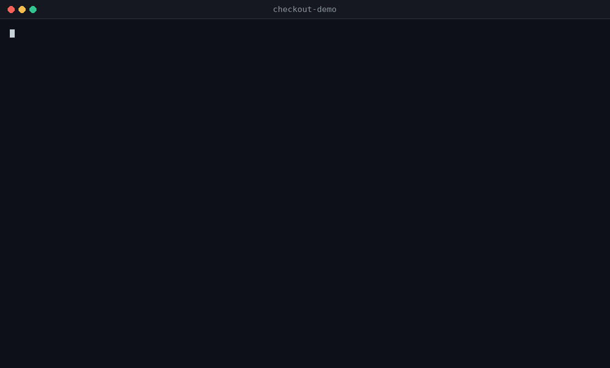

# arnx

Your coding agent says the change is done. arnx tests whether it is.

arnx asks models what your change could have broken, turns each suspicion into a real test, and
runs it in Docker on your code with the change and without it. Every finding is a test that failed.
No failing test, no finding. Keep the tests you want, and they guard that behaviour from then on.



Open source (Apache 2.0). Python, JavaScript/TypeScript and Rust ([early](docs/WORKFLOW.md#rust-crates)).

## Try it

You need Docker running, and macOS or Linux (on Windows, WSL 2).

    npm install -g @arnx-dev/arnx       # Node 20 or later
    export ANTHROPIC_API_KEY=...        # you pay Anthropic directly
    arnx init

    # ... let your agent change something ...

    arnx review                         # the first one also works out how to run your tests

A review costs from a few cents to a few dollars (our own: $0.17 to $3.19) and stops writing tests
at your cap, `review_usd` (default $3.00).

No model keys? `arnx init --cloud`, then `arnx login`: [arnx cloud](docs/CLOUD.md) runs the models,
and new accounts start with $5 of credit. Tests still run in your Docker. No Node? Use a
[standalone binary](docs/WORKFLOW.md#install).

## What `arnx review` does

    1. SET UP     A Docker image that can run your tests, and throwaway copies of your code
    2. SUSPECT    Models read the change and list what may be broken: where, why, an input to try
    3. TEST       A model writes tests for the suspects and runs them with your own test runner
    4. REPEAT     Each test runs 3 times. Only a test that fails all 3 becomes a finding
    5. COMPARE    That test runs again on the code from before your change
    6. CHALLENGE  A second opinion reads the test, the failure and the change.
                  A finding it disputes stays in the report, marked as disputed
    7. REPORT     What failed, what was not tested, and questions only you can answer

Step 5 tells you whether the change is to blame:

| With the change | Before the change | Reported as |
|---|---|---|
| fails | passes | **regression**: the change broke it |
| fails | fails the same way | already broken before the change |
| fails | fails differently | changed |
| fails | the code does not exist yet | new code: nothing to compare |
| fails | no clear result | unknown |

**The tests** are ordinary tests for your project's runner (pytest, vitest, jest, node:test, bun,
cargo-nextest). Where they fit and the library is installed, they are also property-based tests
(hypothesis, fast-check, proptest), which try many generated inputs. arnx does not run a fuzzer.

## What a finding looks like

arnx reviewing its own `arnx remove` command:

```
### Issue 1 · remove --yes can delete files outside the repository
- Actual: In S2, `../victim.txt` outside the repository was deleted. …
- Failing tests: F2, F4

### F2 · regression · confirmed by the second opinion
- Failure: `expect(received).toBe(expected)`
- Before the change (regression): passes on the code before the change (3 runs), fails with it
- Second opinion: planRemove takes accepted-tests.json keys verbatim and applyRemove rmSync's join(repo, p), …
```

We marked it real, a coding agent fixed it, and the test still guards that behaviour:
[tests/remove-safety.test.ts](tests/remove-safety.test.ts).

## Then you decide

    arnx triage     # mark each issue real / intended / noise / rewrite, answer questions
    arnx accept     # keeps the tests of real issues in .arnx/tests/, never in your own suite
    arnx prompt     # prints the fix prompt for your coding agent
    arnx check      # runs the accepted tests, no model involved: green means they pass now

Accepted tests stay and guard that behaviour from then on. arnx never edits your code or your
tests, and `arnx check` refuses to run if an accepted test was edited.

Using Claude Code or another agent that reads Agent Skills? `arnx skill install` lets it run the
review and the fix loop. Marking findings and accepting tests stay yours.
[More](docs/WORKFLOW.md#coding-agents).

## What the results prove

- **A failing test** shows that an assertion fails. The test itself can be wrong: some confirmed
  findings in our own reviews tested behaviour we intended. That is why you mark them.
- **The second opinion** is a model's judgement, not proof. By default it is the same model that
  wrote the test, asked separately. Set another vendor's model in
  [`.arnx/config.toml`](docs/MODELS.md) for a more independent view.
- **A green `arnx check`** covers the behaviour those tests check, nothing more. Changed code no
  test touched is listed as not covered, never as fine.
- **Reviews vary.** Two reviews of the same change can report different findings.

## What leaves your machine

- **Sent to the model provider** (or to arnx cloud, which passes it to its providers): the diff, the
  files the agent reads, its tests and their output.
- **Not sent:** paths in `.arnxignore` and secret files. Values that look like secrets go as fakes of
  the same shape. Untracked files only with `--untracked`. The filter is a heuristic, so extend
  `.arnxignore` for anything else private.
- **In Docker:** tests run on a throwaway copy, with no network (only services in
  `.arnx/review.yaml`), no host environment and resource limits. Docker is not a perfect boundary
  for hostile code, and image builds have network access to install dependencies.
- **Telemetry** is off unless you turn it on. `arnx remove` deletes everything arnx added.

Details: [docs/SAFETY.md](docs/SAFETY.md). Security reports: [SECURITY.md](SECURITY.md).

## Limits

- Works best on single-package Python and TypeScript repositories. Larger ones are set up one part at
  a time, and browser-only tests (Playwright, Cypress) are not run:
  [what arnx covers](docs/SAFETY.md#what-arnx-covers).
- Rust is the least tried: [where it stands](docs/WORKFLOW.md#rust-crates).
- Up to 200 KB of change per review. Split a long branch with `--range A..B`.

## More

[The full workflow](docs/WORKFLOW.md) · [Models and providers](docs/MODELS.md) ·
[arnx cloud](docs/CLOUD.md) · [How arnx works inside](DEVELOPING.md) · [Contributing](CONTRIBUTING.md)

Lost? `arnx next` says the command to run now; `arnx doctor` says what is missing.

Tried it? [Open an issue](https://github.com/arnx-dev/arnx/issues) with what it caught, what it got
wrong, or where setup failed.

Apache License 2.0: see [LICENSE](LICENSE) and [NOTICE](NOTICE).
